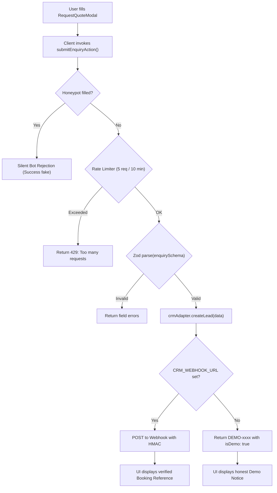

# Codebase Architecture & File Map

High-density architectural index of the **Jeto Vacations** web application. AI agents should reference this map rather than traversing directory trees.

---

## 1. Directory Structure Overview

```
jet-web/
├── AGENTS.md                          # Shared AI agent guidelines & non-negotiables
├── CLAUDE.md                          # Claude Code entry point
├── package.json                       # Next.js 16.4.2, React 19.3.0, Tailwind v4
├── next.config.ts                     # Turbopack rules, Tailwind plugin, remote images
├── eslint.config.mjs                  # ESLint 9 configuration with NTFS ignore rules
├── tests/                             # Native tsx --test unit test suite
│   ├── package-parser.test.mjs        # Parser, price fallback, slug uniqueness tests
│   └── enquiry-validation.test.mjs    # Zod schema, phone/email, honeypot tests
├── docs/
│   ├── ai/                            # AI agent knowledge repository
│   │   ├── CODEBASE_MAP.md            # This document
│   │   ├── CURRENT_STATE.md           # Runtime state, verified features, defects
│   │   ├── CHANGELOG.md               # Commit-by-commit AI engineering log
│   │   ├── NEXT_TASK.md               # Prioritized task for current sprint
│   │   └── decisions/                 # Architecture Decision Records (ADRs)
│   ├── CRM_PUBLIC_API_CONTRACT.md     # Webhook specification for production CRM
│   └── REPOSITORY_AUDIT.md            # Code review and audit findings
└── src/
    ├── app/                           # App Router routes and Server Actions
    ├── components/                    # Feature & shared UI components
    ├── context/                       # React context providers
    ├── data/                          # Package catalogue, static copy, guides
    └── lib/                           # Validation schemas, CRM adapters, utilities
```

---

## 2. Route Map (`src/app/`)

The application compiles 769 static and dynamic routes:

| Route | File Path | Type | Description |
|---|---|---|---|
| `/` | `src/app/page.tsx` | Server + Client | Homepage: Hero with video background, live package search, curated collections, why-jeto, published reviews, quote modal |
| `/holidays` | `src/app/holidays/page.tsx` | Client | Full 433-package catalogue with faceted filtering (region, duration, price, style), sorting, and search |
| `/holidays/[slug]` | `src/app/holidays/[slug]/page.tsx` | Server + Client (442 static pages) | Package detail page: highlights, inclusions/exclusions, pricing disclaimer, and interactive itinerary customizer |
| `/destinations` | `src/app/destinations/page.tsx` | Server | Overview of 29 destinations grouped by region |
| `/destinations/[slug]` | `src/app/destinations/[slug]/page.tsx` | Server + Client (29 pages) | Destination hub: weather, best time to visit, visa guidelines, FAQs, and filtered destination packages |
| `/custom-holiday` | `src/app/custom-holiday/page.tsx` | Client | Step-by-step bespoke travel designer with live budget calculations and custom enquiry submission |
| `/travel-guides` | `src/app/travel-guides/page.tsx` | Server | Travel guide directory with category filtering |
| `/travel-guides/[slug]` | `src/app/travel-guides/[slug]/page.tsx` | Server (133 pages) | Individual travel guide / editorial article |
| `/reviews` | `src/app/reviews/page.tsx` | Server | Paginated published reviews with destination and rating filters |
| `/newblogs/[slug]` | `src/app/newblogs/[slug]/page.tsx` | Server | Legacy blog URL redirect for migrated articles; explicit notice for unmigrated legacy slugs |
| Legacy source routes | `next.config.ts` | Redirects | Maps original destination, about, quote, selector, reviews, terms, and utility URLs to current routes |
| `/proposal/[id]` | `src/app/proposal/[id]/page.tsx` | Client | Proposal viewer: displays custom travel proposal or secure "Proposal Not Found / Expired" screen |
| `/about` | `src/app/about/page.tsx` | Server | Company story, registered business credentials (GSTIN), leadership |
| `/contact` | `src/app/contact/page.tsx` | Server + Client | Office location, phone, email, WhatsApp, and enquiry form |
| `/privacy` | `src/app/privacy/page.tsx` | Server | Legal privacy policy (GDPR/DPDP compliance) |
| `/terms` | `src/app/terms/page.tsx` | Server | Terms of service and booking conditions |
| `/sitemap.xml` | `src/app/sitemap.ts` | Dynamic | Dynamic sitemap generating canonical package, destination, guide, review, and static URLs |
| `/robots.txt` | `src/app/robots.ts` | Dynamic | Search engine indexing rules pointing to sitemap |

---

## 3. Data & Core State Layer (`src/data/` & `src/context/`)

- **`src/data/live-crawled-packages.json`**: 433 crawled packages across 25 destinations containing raw duration, inclusions, itinerary items, and starting prices. **Warning**: Large file (>400 KB); do not dump into LLM context.
- **`src/data/sample-packages.ts`**: Curated, hand-crafted packages (e.g., Swiss Alps Glacier Express, Northern Lights Lapland, Cherry Blossom Kyoto) with priority over crawled data.
- **`src/data/packages-unified.ts`**: The central catalogue engine. Unifies curated and crawled data into `UNIFIED_PACKAGES`, normalizes prices/durations, guarantees unique slugs via deduplication, tags auto-generated itineraries as `suggested_draft`, and exports `getPackageBySlug(slug)` with strict exact-match lookup.
- **`src/data/site-content.ts`**: Single source of truth for branding, metadata, `SITE_ORIGIN` (`https://www.jetovacations.com`), registered address, GSTIN (`07AAECJ6467D1ZI`), and contact numbers.
- **`src/data/customer-reviews.ts`**: Fetches and validates the official public review feed, cached for one hour.
- **`src/data/travel-guides.ts`**: 4 curated guides; 129 crawled guide entries are unified by `travel-guides-unified.ts`.
- **`src/data/proposal-store.ts`**: In-memory proposal storage. Returns `null` for unknown proposal IDs (no dummy customer fallbacks).
- **`src/context/CurrencyContext.tsx`**: React context providing real-time multi-currency conversion (`INR`, `USD`, `EUR`, `GBP`, `AED`).
- **`src/context/QuoteModalContext.tsx`**: React context managing quote modal visibility, pre-selected package title, and pre-selected destination.

---

## 4. Components Architecture (`src/components/`)

- **`src/components/home/`**:
  - `HeroVideo.tsx`: Background looping video (`hero-travel.mp4`) with smooth fallback to high-resolution poster image, gradient overlays, and audio toggle.
  - `SearchCard.tsx`: Instant autocomplete search supporting package titles, destinations, tags, and durations with keyboard navigation.
  - `FeaturedPackages.tsx`: Curated package showcase.
  - `DestinationGrid.tsx`: Visual destination explorer.
  - `WhyJeto.tsx`, `Testimonials.tsx`: Trust & social proof blocks.
  - `CustomerReviews.tsx`: Homepage preview of published traveler reviews with a link to the full review directory.
- **`src/components/holidays/`**:
  - `InteractiveItineraryCustomizer.tsx`: Day-by-day interactive itinerary builder with day reordering, add/remove activity capabilities, and explicit `suggested_draft` banner.
  - `PricingSummary.tsx`: Price display with currency switcher and transparency disclosures.
- **`src/components/common/`**:
  - `RequestQuoteModal.tsx`: Accessible multi-step modal enquiry form with step validation, honeypot spam protection, pre-filled package context, and honest demo/live submission state alerts.
  - `Navbar.tsx`: Responsive navigation with desktop dropdowns, currency selector, and mobile slide-over menu.
  - `Footer.tsx`: Published office address, business registration details, canonical links, newsletter subscription, reviews, and legal links.

---

## 5. Backend & Server Actions (`src/app/actions/` & `src/lib/`)



- **`src/app/actions/enquiry.ts`**: Next.js Server Action (`'use server'`). Enforces in-memory sliding window rate-limiting per client IP and validates payloads against `enquirySchema`.
- **`src/lib/validations/enquiry.ts`**: Zod schema validating traveler name, email, phone (with international dial codes), travel dates, traveler count, budget range, and mandatory privacy consent.
- **`src/lib/api/crm-adapter.ts`**: Adapter for CRM integration. When `CRM_WEBHOOK_URL` is configured, it dispatches the lead via HTTP POST. When unconfigured, it returns a demo response with `isDemo: true` and an explicit note that the submission was simulated.
- **`src/lib/api/types.ts`**: Strict TypeScript interfaces for `EnquiryPayload`, `LeadSubmissionResult`, and CRM contracts.
